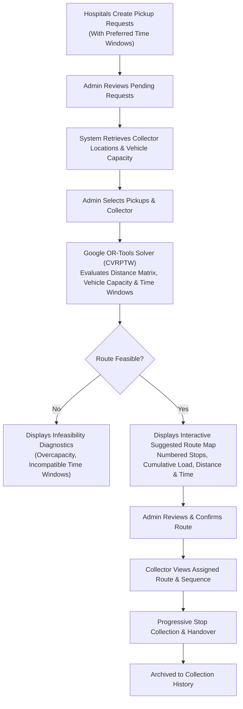
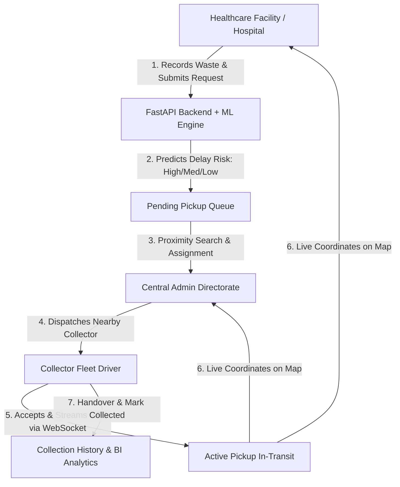

# Smart Medical-Waste Collection System
### Full-Stack Web Application + Multi-Stop OR-Tools Optimization + Monthly Waste Audit + ML Delay Risk Prediction


A complete, production-grade **Smart India Hackathon** platform deployed for **Salem, Tamil Nadu, India**, digitally managing hospital biomedical waste recording, monthly segregation audit dashboards with statutory PDF/CSV reporting, multi-stop route optimization using Google OR-Tools (CVRPTW), admin-controlled collector assignment, live GPS telemetry tracking, collection history, system analytics, and machine-learning-based pickup delay risk prediction.

---

## 1. Project Overview & Problem Statement

Improper and delayed collection of biomedical waste in healthcare facilities poses catastrophic biohazard contamination risks, disease transmission vulnerabilities, and severe regulatory non-compliance under the **Bio-Medical Waste Management Rules, 2016** (Central Pollution Control Board / Tamil Nadu Pollution Control Board). Traditional systems suffer from manual paper-based logging, single-stop nearest-neighbor inefficiencies, lack of segregation oversight, and opaque logistical delays.

**The Solution:**
The **Smart Medical-Waste Collection System** provides an end-to-end governed digital pipeline:
1. **Hospitals (Salem, Tamil Nadu)** record segregated biomedical waste batches (Yellow, Red, White, Blue) and submit pickup requests with preferred time windows.
2. **Monthly Hospital Medical-Waste Audit Dashboard**: Monitors category breakdowns (Sharps, Anatomical, Cytotoxic, General) against Bio-Medical Waste Management Rules 2016, detects segregation inconsistencies, logs justification corrections, and exports official statutory PDF and CSV reports.
3. **Scikit-Learn Random Forest ML Model**: Predicts the probability of collection delay and classifies requests into 🔴 **HIGH DELAY RISK** (≥65%), 🟡 **MEDIUM DELAY RISK** (35%-64%), or 🟢 **LOW DELAY RISK** (<35%).
4. **Google OR-Tools Multi-Stop Route Optimizer**: Formulates a Capacitated Vehicle Routing Problem with Time Windows (CVRPTW) considering vehicle carrying capacities, hospital collection time windows, and travel distance to generate fuel-efficient multi-hospital routes.
5. **Central Admin Governance**: Evaluates suggested multi-stop routes or individual proximity dispatches and confirms assignments. The Admin retains sole dispatch authority.
6. **Collector Fleet View**: Collectors receive ordered stop sequences with turn-by-turn routes on interactive maps, stream live GPS telemetry, and mark stops collected progressively.
7. **Collection Completion**: Archives pickups to immutable collection histories and analytics dashboards.

---

## 2. Salem, Tamil Nadu Operational Mapping

All healthcare facilities, collector depots, and administrative offices have been consolidated to **Salem, Tamil Nadu, India** using precise coordinates:

| Entity Name | Locality / Landmark | Latitude | Longitude | Role |
| :--- | :--- | :---: | :---: | :--- |
| **Apollo Care Hospital** | Meyyanur Main Road, Salem | `11.6715` | `78.1332` | Hospital |
| **City Life Trauma Center** | Mamangam Bypass Rd, Salem | `11.6965` | `78.1215` | Hospital |
| **St. Jude Super Specialty** | Cherry Road, Hasthampatti, Salem | `11.6752` | `78.1580` | Hospital |
| **Metro General Hospital** | NH-47, Seeragapadi, Salem | `11.6210` | `78.0750` | Hospital |
| **City Hospital / GOVH** | Fort Main Road, Salem | `11.6538` | `78.1560` | Hospital |
| **TNPCB Zonal Directorate** | Collectorate Complex, Salem | `11.6730` | `78.1520` | Central Admin |
| **Rajesh Kumar (Fleet #1)** | Gugai / Shevapet Depot, Salem | `11.6495` | `78.1480` | Collector (Eicher Pro, 500 kg) |
| **Priya S. (Fleet #2)** | Five Roads Transport Hub, Salem | `11.6685` | `78.1360` | Collector (Tata 407, 400 kg) |
| **Venkatesh R. (Fleet #3)** | Junction Road, Suramangalam | `11.6850` | `78.1220` | Collector (Mahindra Bolero, 350 kg) |
| **Anand M. (Fleet #4)** | Cuddalore Main Rd, Ammapet | `11.6520` | `78.1810` | Collector (Force Traveller, 450 kg) |
| **Murugan K. (Fleet #5)** | Steel Plant Road, Salem | `11.6410` | `78.0950` | Collector (Ashok Leyland Dost, 300 kg) |

*Dynamic Location Selector*: The registration and profile modules support 1-click Salem locality quick presets (Meyyanur, Hasthampatti, Mamangam, Shevapet, Ammapet, Suramangalam), browser GPS auto-detection, and manual latitude/longitude input.

---

## 3. Future Enhancement 1 — Google OR-Tools Multi-Stop Route Optimization

Rather than simple nearest-neighbor calculations or single-hospital dispatching, the system implements a production **Capacitated Vehicle Routing Problem with Time Windows (CVRPTW)** solver powered by **Google OR-Tools**:



### Key Solver Constraints:
1. **Travel Distance & Distance Matrix**: Computes accurate Haversine/Manhattan distance matrix between collector starting depot, all candidate hospital pickup stops, and return.
2. **Vehicle Carrying Capacity**: Each collector has a configured vehicle model (e.g. Tata 407, Eicher Pro) and certified payload capacity (kg). Pickups cannot be assigned if total cumulative waste exceeds capacity.
3. **Pickup Time Windows**: Supports hospital operational shifts:
   - *Morning*: 08:00 - 12:00
   - *Midday*: 11:00 - 15:00
   - *Afternoon*: 13:00 - 17:00
   - *Evening*: 16:00 - 20:00
   - *Full Day*: 08:00 - 20:00
4. **Admin Confirmation**: Proposes optimal sequence; Admin must review and confirm before dispatch. Collector cannot self-assign; Admin retains sole authority.

---

## 4. Future Enhancement 2 — Monthly Hospital Medical-Waste Audit Dashboard

To ensure compliance with statutory environmental standards, hospitals and administrators have access to an integrated **Monthly Waste Audit Dashboard**:

### Key Features:
- **Segregation Breakdown**: Exact monthly metrics and charts across **Sharps**, **Anatomical**, **Cytotoxic**, and **General** waste.
- **Automated Bio-Medical Waste Segregation Validation**: Implements rules based on India Bio-Medical Waste Management Rules, 2016:
  - ⚠️ *Yellow Category*: Anatomical and cytotoxic waste must be routed here; sharps or recyclables flagged.
  - ⚠️ *Red Category*: Contaminated recyclables (tubings, gloves, bottles); non-recyclables or sharps flagged.
  - ⚠️ *White Category*: Exclusively reserved for puncture-proof sharps, needles, blades, scalpels.
  - ⚠️ *Blue Category*: Glassware, medicine ampoules, orthopedic implants.
  - ⚠️ *General Waste Isolation*: Warns if general municipal waste is mixed into biohazard streams.
- **Correction Workflow & Audit Trail**: Hospitals can correct miscategorized records with documented justification reasons. Original categories and changes are recorded in the `waste_corrections` audit log.
- **Official Compliance Reports**:
  - **High-Quality PDF Export**: Built with `reportlab`, containing official header, hospital details, category metrics table, segregation warnings, and statutory certification disclaimers.
  - **CSV Manifest Export**: Complete machine-readable audit report for Pollution Control Board audits.
- **Admin System-Wide Overview**: Central Admin can audit any hospital across Salem, monitor warning resolution rates, and inspect correction logs.

---

## 2. Core Business Rules

> [!IMPORTANT]
> **Admin-Controlled Nearby Collector Assignment Rule**:
> - Hospitals **CANNOT** select, favor, or permanently bind a collector.
> - A hospital only records waste, creates pickup requests, and monitors active progress.
> - The **Admin** has exclusive authority to review available certified collectors sorted by Haversine distance and confirm dispatch.
> - A collector receives requests from multiple hospitals; a hospital receives dispatches from different nearby collectors.
> - When a pickup reaches `status = 'Collected'`, it is immediately removed from all active queues and visible only in **Collection History**.

---

## 3. Technology Stack

| Layer | Technologies Used | Description |
| :--- | :--- | :--- |
| **Frontend** | React.js 18, Vite, Tailwind CSS, Lucide React, Recharts, React Router v7, Leaflet, Axios, React Hot Toast | Modern, healthcare-tailored responsive light theme UI (No dark mode). High-fidelity interactive dashboards, live map overlays, and charts. |
| **Backend** | Python 3.14+, FastAPI, Uvicorn, SQLAlchemy ORM, Pydantic v2, WebSockets | Asynchronous REST APIs, role-based authorization dependencies, live WebSocket GPS streaming per pickup ID. |
| **Database** | SQLite (Production SQLAlchemy ORM structure) | Clean schema designed with strict foreign key constraints, readily portable to PostgreSQL. |
| **Authentication** | JWT (JSON Web Tokens), Bcrypt Password Hashing | Never stores plaintext passwords (`password_hash` column). Role-based route protection on server and client. |
| **Machine Learning** | Python, Scikit-Learn, Pandas, NumPy, Joblib | 100% real trained `RandomForestClassifier` with an 80/20 stratified train/test split, Scikit-Learn `Pipeline`, `ColumnTransformer`, and test evaluation metrics. |
| **Geolocation** | Browser Geolocation API (`watchPosition`), Haversine Formula, Dual Map Engine (Google Maps JS API + Leaflet/OpenStreetMap fallback) | Live real-time collector tracking without page refresh. |

---

## 4. User Roles & Dashboards



### A. Hospital / Clinic
- Record biomedical waste with color category, mass (kg), storage notes.
- Schedule pickup requests with storage duration calculation.
- Preview ML predicted delay risk tier prior to submission.
- Track assigned collector vehicle moving live on the interactive map via WebSockets.
- Access dedicated facility waste generation analytics & collection history.

### B. Collector Fleet Driver
- View pickup requests assigned specifically by the Admin.
- View **prominently displayed ML Delay Risk Badges** (🔴 HIGH DELAY RISK, 🟡 MEDIUM DELAY RISK, 🟢 LOW DELAY RISK).
- View destination hospital details, address, and proximity.
- Accept assigned pickups to initiate active GPS tracking.
- Transmit live GPS coordinates (supports native device GPS or built-in 1-click route simulation for desktop testing).
- Mark pickup completed upon facility arrival.
- Access driver personal collection logbook.

### C. Central Admin Directorate
- System-wide command center with total mass collected, active fleet, and hospital stats.
- Review pending pickup queue and trigger nearby collector calculation.
- View Haversine distance in kilometers for all certified collectors.
- Assign the optimal available collector with 1 click.
- Monitor state-wide active fleet on the live radar tracking map.
- Inspect the dedicated **AI Model & Metrics Center** with real test dataset evaluation.
- Export immutable CSV manifests for environmental regulatory compliance.

---

## 5. Biomedical Waste Color Segregation Standards

| Color Category | Target Waste Stream | Containment Protocol | Inherent Hazard Risk |
| :--- | :--- | :--- | :---: |
| **Yellow** | Human anatomical tissues, organs, soiled dressings, expired pharmaceuticals, microbiology cultures | Yellow non-chlorinated bags • High-temperature incineration / deep burial | **Risk 4 (High)** |
| **Red** | Contaminated recyclable plastics, disposable gloves, IV tubes, catheters, urine bags | Red autoclavable containers • Autoclaving / shredding / recycling | **Risk 3 (Moderate-High)** |
| **White** | Needles, scalpels, surgical blades, contaminated sharps | White puncture-proof sealed containers • Dry heat sterilization / encapsulation | **Risk 4 (High Puncture)** |
| **Blue** | Glass ampoules, broken medicine vials, metallic orthopedic implants | Blue puncture-resistant boxes • Disinfection & glass furnace recycling | **Risk 2 (Moderate)** |

---

## 6. Machine Learning Engine & Reproducibility

### Academic Dataset Transparency Statement
> **Notice**: The training dataset (`ml/data/medical_waste_pickup_dataset.csv`) is a synthetic dataset generated specifically for this project because real operational hospital biomedical waste logs are restricted under healthcare privacy and municipal security regulations. The dataset is engineered according to India Bio-Medical Waste Management Rules and realistic operational distributions.

### Feature Dictionary

| Feature Name | Type | Description |
| :--- | :--- | :--- |
| `waste_category` | Categorical | `Yellow`, `Red`, `White`, `Blue` |
| `waste_quantity` | Numerical | Mass of waste batch (2.0 - 180.0 kg) |
| `storage_duration_hours` | Numerical | Time elapsed in hospital containment (1.0 - 72.0 hrs) |
| `request_waiting_hours` | Numerical | Time elapsed since ticket creation (0.2 - 36.0 hrs) |
| `waste_risk_level` | Numerical | Biohazard risk score (Yellow/White=4, Red=3, Blue=2) |
| `pickup_distance_km` | Numerical | Distance to collection cluster (0.5 - 30.0 km) |
| `previous_delay_hours` | Numerical | Logistical delay in sector (0.0 - 18.0 hrs) |
| `hospital_request_frequency`| Numerical | Average weekly pickups (bed capacity indicator) |
| `collector_availability` | Numerical | Number of available collectors in zone (1 - 5) |
| `day_of_week` | Numerical | Day of week integer (0 = Mon, 6 = Sun) |
| `time_of_day` | Numerical | Hour of day (0 - 23 hrs) |

**Target Variable:** `is_delayed` (0 = On-Time, 1 = Delayed) mapped to `HIGH DELAY RISK` (≥65%), `MEDIUM DELAY RISK` (35%-64%), and `LOW DELAY RISK` (<35%).

### Model Architecture & Test Evaluation
- **Preprocessing Pipeline**: Scikit-Learn `ColumnTransformer` with `OneHotEncoder(handle_unknown='ignore')` for categories and `SimpleImputer` + `StandardScaler` for numerical attributes.
- **Classifier**: `RandomForestClassifier(n_estimators=150, max_depth=12, min_samples_split=4, class_weight='balanced', random_state=42)`
- **Evaluation Split**: 80% Training (1,440 records) / 20% Stratified Unseen Testing (360 records)
- **Authentic Test Metrics**:
  - Test Accuracy: **~70.3%**
  - ROC-AUC Score: **~77.2%**
  - Delay Precision: **~66.5%**
  - Delay Recall: **~64.3%**
  - Delay F1-Score: **~65.4%**

### ML Pipeline Commands
```bash
# 1. Generate Delay Dataset (>= 1,600 records)
python ml/generate_dataset.py

# 2. Train Model & Export Pipeline (.joblib & metrics.json)
python ml/train_model.py

# 3. Evaluate Saved Artifact on 20% Unseen Test Set
python ml/evaluate_model.py

# 4. Export Summary and Metrics CSV
python ml/export_model_csv.py
```

---

## 7. Database Architecture (SQLite / SQLAlchemy)

### Database Tables & Schema

1. **`users`**:
   - `id` (INT, PK), `name` (VARCHAR), `email` (VARCHAR, Unique, Indexed), `phone` (VARCHAR), `password_hash` (VARCHAR - Bcrypt hash, never plaintext), `role` (`hospital` | `collector` | `admin`), `address` (VARCHAR), `latitude` (FLOAT), `longitude` (FLOAT), `vehicle_number` (VARCHAR, Nullable), `vehicle_type` (VARCHAR, Nullable), `vehicle_capacity_kg` (FLOAT, Default 400.0), `created_at` (DATETIME).

2. **`waste_records`**:
   - `id` (INT, PK), `hospital_id` (INT, FK -> users.id), `category` (`Yellow` | `Red` | `White` | `Blue`), `waste_type` (VARCHAR), `quantity` (FLOAT), `unit` (VARCHAR default "kg"), `notes` (VARCHAR), `is_scheduled` (BOOLEAN), `audit_classification` (VARCHAR), `has_sorting_warning` (BOOLEAN, default False), `warning_reason` (VARCHAR, Nullable), `is_corrected` (BOOLEAN, default False), `original_category` (VARCHAR, Nullable), `created_at` (DATETIME).

3. **`pickup_requests`**:
   - `id` (INT, PK), `hospital_id` (INT, FK -> users.id), `collector_id` (INT, FK -> users.id, Nullable), `waste_record_id` (INT, FK -> waste_records.id), `route_id` (INT, FK -> optimized_routes.id, Nullable), `stop_order` (INT, Nullable), `preferred_time_window` (VARCHAR), `time_window_start_min` (INT), `time_window_end_min` (INT), `status` (`Pending` | `Assigned` | `Accepted` | `Collected` | `Cancelled`), `delay_risk` (`High` | `Medium` | `Low`), `delay_probability` (FLOAT), `prediction_timestamp` (DATETIME), `model_version` (VARCHAR), `priority` (Backward compatibility), `priority_confidence` (FLOAT), `pickup_address` (VARCHAR), `hospital_latitude` (FLOAT), `hospital_longitude` (FLOAT), `storage_duration_hours` (FLOAT), `requested_at` (DATETIME), `assigned_at` (DATETIME), `accepted_at` (DATETIME), `completed_at` (DATETIME).

4. **`collector_locations`**:
   - `id` (INT, PK), `collector_id` (INT, FK -> users.id), `pickup_id` (INT, FK -> pickup_requests.id), `latitude` (FLOAT), `longitude` (FLOAT), `updated_at` (DATETIME).

5. **`optimized_routes`** *(New)*:
   - `id` (INT, PK), `collector_id` (INT, FK -> users.id), `total_distance_km` (FLOAT), `total_duration_minutes` (FLOAT), `total_waste_kg` (FLOAT), `vehicle_capacity_kg` (FLOAT), `status` (`suggested` | `confirmed` | `in_progress` | `completed` | `cancelled`), `solver_status` (VARCHAR), `created_at` (DATETIME), `confirmed_at` (DATETIME), `completed_at` (DATETIME).

6. **`route_stops`** *(New)*:
   - `id` (INT, PK), `route_id` (INT, FK -> optimized_routes.id), `pickup_id` (INT, FK -> pickup_requests.id), `stop_order` (INT), `hospital_name` (VARCHAR), `hospital_address` (VARCHAR), `latitude` (FLOAT), `longitude` (FLOAT), `waste_quantity_kg` (FLOAT), `waste_category` (VARCHAR), `preferred_time_window` (VARCHAR), `time_window_start_min` (INT), `time_window_end_min` (INT), `distance_from_prev_km` (FLOAT), `est_arrival_time` (VARCHAR), `status` (`pending` | `collected` | `skipped`), `collected_at` (DATETIME).

7. **`waste_corrections`** *(New)*:
   - `id` (INT, PK), `waste_record_id` (INT, FK -> waste_records.id), `hospital_id` (INT, FK -> users.id), `user_id` (INT, FK -> users.id), `previous_category` (VARCHAR), `new_category` (VARCHAR), `justification_reason` (VARCHAR), `corrected_at` (DATETIME).

---

## 8. Primary FastAPI REST & WebSocket Endpoints

| Method | Endpoint | Access Role | Description |
| :--- | :--- | :--- | :--- |
| `POST` | `/api/auth/register` | Public | Registers Hospital or Collector with Salem geolocation and vehicle details |
| `POST` | `/api/auth/login` | Public | Authenticates credentials and returns JWT Bearer Token |
| `GET` | `/api/auth/me` | Authenticated | Returns profile of current logged-in user |
| `POST` | `/api/waste` | Hospital | Records new biomedical waste batch with automatic segregation checking |
| `GET` | `/api/waste` | Hospital / Admin | Lists waste batches (Hospital sees own, Admin sees all) |
| `POST` | `/api/pickups` | Hospital | Submits pickup request with preferred time window & ML delay risk prediction |
| `GET` | `/api/pickups` | Authenticated | Role-filtered pickup request listings with delay_risk sorting |
| `POST` | `/api/routes/optimize` | Admin | Runs Google OR-Tools CVRPTW solver for selected pickups & collector |
| `POST` | `/api/routes/confirm` | Admin | Explicitly confirms and dispatches an optimized multi-stop route |
| `GET` | `/api/routes/active` | Collector | Returns active multi-stop route assigned to the logged-in collector |
| `GET` | `/api/routes` | Admin | Lists all planned and confirmed routes with status tracking |
| `PUT` | `/api/routes/{route_id}/stops/{stop_id}/status` | Collector / Admin | Updates individual stop status (`collected`) during multi-stop tour |
| `GET` | `/api/audit/monthly` | Hospital | Monthly waste segregation metrics, warnings, and history |
| `GET` | `/api/audit/admin-overview` | Admin | System-wide monthly audit metrics and hospital warning oversight |
| `PUT` | `/api/audit/correct-waste/{waste_id}` | Hospital | Corrects miscategorized waste with justification audit record |
| `GET` | `/api/audit/report/pdf` | Hospital / Admin | Generates statutory PDF Monthly Audit Report via ReportLab |
| `GET` | `/api/audit/report/csv` | Hospital / Admin | Exports comprehensive CSV compliance manifest |
| `GET` | `/api/admin/collectors/nearby/{pickup_id}` | Admin | Computes Haversine distance to available fleet units |
| `PUT` | `/api/admin/pickups/{pickup_id}/assign` | Admin | Dispatches selected collector to pickup request |
| `GET` | `/api/collector/pickups/assigned` | Collector | Lists requests assigned by admin with ML Delay Risk badges |
| `PUT` | `/api/collector/pickups/{pickup_id}/accept` | Collector | Accepts dispatch; triggers active GPS lifecycle |
| `PUT` | `/api/collector/pickups/{pickup_id}/complete` | Collector | Confirms collection; stops GPS; archives to history |
| `POST` | `/api/location/update` | Collector | Telemetry GPS updates during active dispatch |
| `GET` | `/api/history` | Authenticated | Role-isolated completed collection archive |
| `GET` | `/api/analytics/overview` | Authenticated | Real-time computed database statistics |
| `GET` | `/api/analytics/pickup-delay-risk` | Authenticated | Breakdown across HIGH, MEDIUM, LOW delay risks |
| `POST` | `/api/ml/predict-delay-risk` | Public / App | Direct ML Random Forest delay probability and risk prediction |
| `GET` | `/api/ml/metrics` | Public / App | Returns authentic 20% test set evaluation metrics |
| `GET` | `/api/ml/model-info` | Public / App | Active model hyperparameters, features, and version |
| `WS` | `/ws/location/{pickup_id}` | WebSocket | Real-time bi-directional GPS broadcast stream |

---

## 9. Quick Installation & Setup

### Prerequisites
- **Python 3.10+** (Tested on Python 3.14)
- **Node.js 18+** & **npm 9+** (Tested on Node v22)

### Step 1: Clone Repository
```bash
git clone https://github.com/your-username/smart-medical-waste-collection.git
cd "smart medical waste collection system"
```

### Step 2: Set Up Backend & Machine Learning
```bash
# Create Python virtual environment
python -m venv venv

# Activate virtual environment (Windows PowerShell)
.\venv\Scripts\Activate.ps1
# (On Linux/macOS: source venv/bin/activate)

# Install Python dependencies (including ortools and reportlab)
pip install -r backend/requirements.txt

# Migrate Database to Salem, Tamil Nadu & create new schema tables
python backend/migrate_salem_and_enhancements.py

# Generate ML Dataset, Train Random Forest, and Evaluate
python ml/generate_dataset.py
python ml/train_model.py
python ml/evaluate_model.py
```

### Step 3: Set Up Frontend
```bash
cd frontend
npm install
npm run build # Validates zero-error production build
```

### Step 4: Run the Application

**Terminal 1 — Backend (FastAPI):**
```bash
# In project root with active venv:
python backend/run.py
# Backend runs at http://127.0.0.1:8000
# Interactive API Docs at http://127.0.0.1:8000/docs
```

**Terminal 2 — Frontend (Vite React):**
```bash
cd frontend
npm run dev
# Frontend runs at http://localhost:5173
```

---

## 10. Default Demo Accounts (Quick 1-Click Login)

For instant testing, the application includes pre-seeded demo accounts in Salem, Tamil Nadu with rich operational histories:

| Role | Email | Password | Pre-configured Data |
| :--- | :--- | :--- | :--- |
| **Admin** | `admin@smartmedwaste.org` | `Admin@123456` | Salem Zonal Office, Multi-Stop OR-Tools Optimizer, System-Wide Waste Audit |
| **Hospital** | `apollo@medcare.org` | `Password@123` | Apollo Care Hospital (Meyyanur, Salem), Waste Audit Dashboard, PDF/CSV Reports |
| **Collector** | `rajesh.collector@bioclean.in` | `Password@123` | Rajesh Kumar (Eicher Pro #TN-27-E-1024, 500 kg), Assigned Multi-Stop Route & GPS |

*(You can also use the ⚡ **Quick Demo 1-Click Login** buttons directly on the Login page).*

---

## 11. Complete End-to-End Test Workflow Walkthrough

### Workflow A: Multi-Stop Route Optimization Using Google OR-Tools
1. **Hospital Schedules Pickups**:
   - Hospital logs in, navigates to **Schedule Pickup**, selects waste batch, and chooses preferred collection time window (e.g. *Morning: 08:00 - 12:00* or *Afternoon: 13:00 - 17:00*).
2. **Admin Generates Multi-Stop Route**:
   - Admin logs in, navigates to **Route Optimization** (`/admin/route-optimization`).
   - Admin selects multiple pending hospital pickup requests across Salem (e.g. Apollo Care, St. Jude, Metro General).
   - Admin selects an available Collector (e.g., Rajesh Kumar - Eicher Pro, 500 kg capacity).
   - System triggers **Google OR-Tools CVRPTW Solver**, checking vehicle capacity constraints and time windows.
   - The interactive Leaflet map displays the numbered stop sequence (Depot -> Stop 1 -> Stop 2 -> Depot), total distance, travel duration, and capacity utilization bar.
3. **Admin Confirms Route**:
   - Admin clicks **Confirm & Dispatch Route**. Route status transitions to `confirmed`.
4. **Collector Executes Tour**:
   - Collector logs in, navigates to **Optimized Route** (`/collector/route`).
   - Collector reviews ordered stop sequence, Salem addresses, and turn-by-turn map.
   - For each stop, Collector clicks **Mark Stop Collected**. Once all stops are collected, route marks complete and pickups move to collection history.

### Workflow B: Monthly Hospital Medical-Waste Audit & Statutory Report
1. **Hospital Waste Segregation Dashboard**:
   - Hospital logs in, navigates to **Monthly Waste Audit** (`/hospital/audit`).
   - Dashboard presents month-by-month waste generation broken down into **Sharps**, **Anatomical**, **Cytotoxic**, and **General**.
   - Interactive Recharts Pie and Bar charts visualize the waste distribution.
2. **Automated Segregation Warnings**:
   - If a record has an inconsistency (e.g. "Scalpels / Needles" logged under "Red" instead of "White", or "Placentas" under "Red" instead of "Yellow"), an amber warning badge highlights the issue citing Bio-Medical Waste Management Rules 2016.
3. **Audit Correction Flow**:
   - Hospital staff clicks **Correct Category**, chooses the compliant category, and enters a mandatory justification note.
   - The change is saved, the warning is resolved, and an immutable log entry is committed to `waste_corrections`.
4. **Export Statutory Compliance Reports**:
   - Hospital clicks **Export PDF Report** to download an official formatted report generated on-the-fly with ReportLab.
   - Hospital clicks **Export CSV Report** to download the raw data manifest for Pollution Control Board inspections.
5. **Admin System-Wide Audit Oversight**:
   - Admin logs in, navigates to **Monthly Waste Audit** (`/admin/audit`), inspects system-wide segregation statistics, filters by hospital, and reviews pending sorting warnings.

---

## 12. Verification & Testing

To run the automated backend test suite:
```bash
.\venv\Scripts\python -m pytest backend/tests/test_api.py -v
```
All tests verify:
- ✅ Hospital & Collector Registration in Salem, Tamil Nadu
- ✅ Bcrypt Password Hashing & JWT Verification
- ✅ Role Authorization & Permission Enforcement
- ✅ Medical Waste Recording with automated segregation checks
- ✅ Google OR-Tools CVRPTW Multi-Stop Route Optimization & Admin Confirmation
- ✅ Collector Active Route Retrieval & Stop-by-Stop Collection Workflow
- ✅ Monthly Waste Audit Aggregations & India Bio-Medical Waste Management Rules 2016 Validation
- ✅ Audit Correction Logging with Justification Audit Records
- ✅ ReportLab PDF and CSV Report Generation
- ✅ Real Random Forest Priority Classification on Request Creation
- ✅ Admin Nearby Collector Distance Calculation & Assignment
- ✅ Collector Acceptance & Live GPS Location Broadcast
- ✅ Pickup Completion & Active Queue De-listing
- ✅ Role-Isolated Collection History & Analytics Computations
- ✅ Frontend compiles with zero build errors (`tsc && vite build`).

---

## 13. License & Academic Accreditation

Developed for academic demonstration and the **Smart India Hackathon** biomedical waste management initiative. Free for educational and non-commercial research use.
